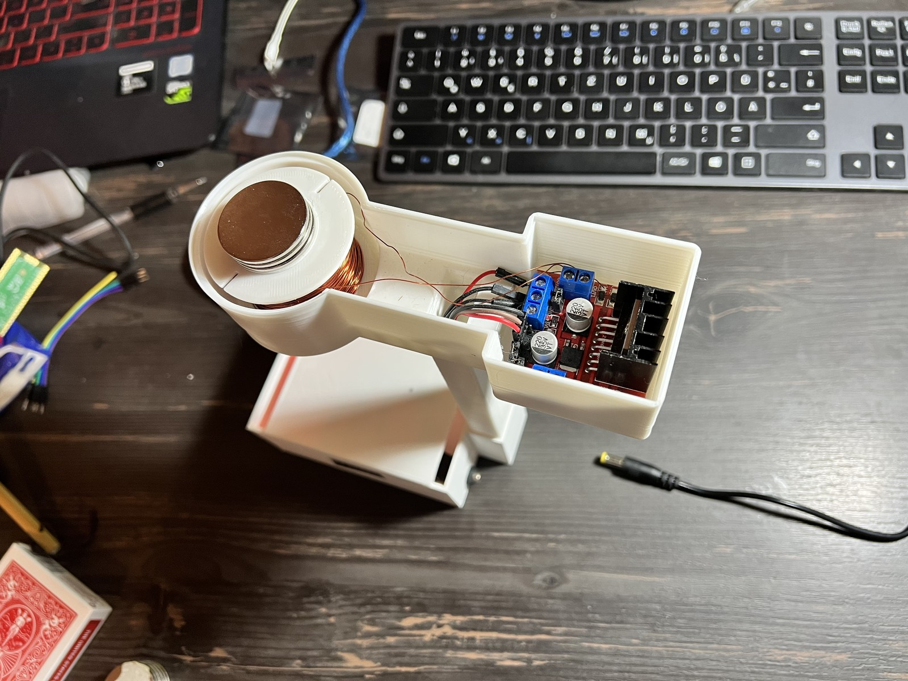

# MagLev Electromagnet Levitator for Arduino



A desk-top magnetic levitation stand. A permanent magnet on top of a hand-wound coil pulls a small neodymium "floater" upwards; a linear Hall sensor under the coil watches the floater, and an Arduino Uno runs a fast proportional-derivative loop that pushes the coil just hard enough to keep the floater hanging in free air. Two sketches are included: a basic version where you set the balance point and gains by hand, and an adaptive version that detects when a floater is placed under the coil, learns its balance point and switches the coil off when it is removed. This is a refurbished remix of [MagLev-Project](https://github.com/xiaochutan123l/MagLev-Project) by xiaochutan123l (GitHub, MIT).

## Install and build guide

Remix of the MagLev-Project by xiaochutan123l (GitHub, MIT, commit c0a467f2b4bc). Written from scratch from the upstream README, the Chinese write-up, the two sketches and the schematic. Read the whole guide once before buying magnets.

### 1. Software first

1. Install the Arduino IDE (2.x). Board: **Arduino Uno**.
2. Install the **TM1637** library (Grove 4-digit display) from the Library Manager if you use the display; otherwise comment out the `tm.*` lines and print `filtValue` to Serial instead.
3. The two sketches are in the [`src/`](src/) folder of this repository (unmodified from the original project):
   - `pullUpMagLev.ino`, the basic version: fixed `adjustValue` (240 in the file), `kp = 20`, `kd = 5`, 20-sample mean filter, coil only pushes.
   - `pullUpMagLev_adaptive.ino`: records the sensor value with no floater, detects a floater from the change, learns the balance point while you hold the floater, and turns the coil off when the floater is removed.
4. Pin table (from the sketches):

| Signal | Uno pin |
|---|---|
| Hall amplifier output | A1 |
| Adjust trimmer | A2 |
| L298N IN1 / IN2 | D4 / D5 |
| L298N ENA (PWM) | D6 |
| TM1637 CLK / DIO | D2 / D3 |

5. Upload the basic sketch with the coil disconnected and watch the display or serial monitor change as you bring a magnet near the Hall sensor.

### 2. Printing the parts

Print one each of `base.stl`, `base_lid.stl`, `top.stl`, `top_lid.stl`, `pole.stl` and `coil-former.stl`. All files are in [`print-files/`](print-files/). `full.stl` is the assembled reference model and is not a print part; `full.3dm` is the Rhino source if you want to change the design. PLA, 0.2 mm layers, 3 walls, 20 % infill. The coil former needs no supports; print the top with its open side up.

### 3. Winding the coil

Upstream gives no wire gauge or turn count, only that the coil is hand-wound on the printed former. Starting point (inferred): 0.3 mm enamelled wire, wind neatly layer by layer until the former is full, then measure the resistance: aim for roughly 10 to 15 ohm so a 12 V supply gives about 1 A through the L298N. Leave 15 cm tails, scrape the enamel with a knife and tin them. Fix the winding with a few drops of CA or tape.

Press the pole piece into the former and stack the top permanent magnets on the pole; they do the lifting, the coil only corrects.

### 4. Electronics

Follow the schematic (the `04-schematic` image in the listing photos; the PDF version is [`images/Schematic_MagLev.pdf`](images/Schematic_MagLev.pdf) in this repository) for the amplifier board:

- Hall sensor (49E) on a small perfboard, powered from 5 V, output into one half of the LM358 as a non-inverting amplifier; the trimmer sets gain/offset so the resting output sits mid-range (about 2.5 V, reading around 500 on A1).
- Mount the Hall sensor on the pole directly under the coil, facing down, as in the upstream photos.
- L298N: coil across OUT1/OUT2, 12 V in, 5 V jumper on so the module makes 5 V for the Uno, IN1 D4, IN2 D5, ENA D6.

WARNING: the coil is an inductive load. The L298N module has flyback diodes on board; never drive the coil from a bare MOSFET without a diode. The L298N heats up at 1 A; keep its heatsink clear. Never leave the coil energised at full duty with the floater removed (the adaptive sketch handles this; the basic one does not).

### 5. Assembly

1. Fit the Hall/amp board and the L298N in the base, feed the wires through the pole, and mount the coil former with the magnets on top.
2. Close the lids last, after tuning.

### 6. Tuning and first levitation

1. Find the balance point: hold the floater under the coil and raise it slowly until it feels weightless; a little above that point is `adjustValue`. Read the value on the display or serial monitor.
2. Set `kp` first: increase it until the floater wobbles once or twice when you let go, then stop.
3. Set `kd` by decades (0.01, 0.1, 1, ...) until the floater hangs still. If it gets worse, go back one step.
4. The loop runs as fast as the Uno can sample 20 readings; keep the filter, the Hall sensor is noisy.
5. For the adaptive sketch: power up with no floater, then hold the floater at the balance point for a few seconds until it takes over.

### 7. Troubleshooting

- Floater snaps to the magnet: `adjustValue` too high or `kp` too low.
- Floater drops: balance point too low, coil too weak (resistance too high), or supply sag.
- Oscillation: `kd` too high or too low; sweep it. Also check the amplifier is not clipping.
- Sensor reads a constant: wrong Hall sensor type (needs a linear one, not a switch), or the sensor is not under the pole.

### 8. Safety

Neodymium magnets pinch hard and shatter when they slam together; keep them away from children, pacemakers, cards and laptops. The coil gets warm; do not run unattended.

### Credits

Original project: MagLev-Project by xiaochutan123l, https://github.com/xiaochutan123l/MagLev-Project (MIT, commit c0a467f2b4bc4826393713b87079967ffd5edca8). Build path, guide and Bill of Material are Hawkridge additions.

## Bill of Material and build guide (PDF)

- **Bill of Material:** [`docs/MagLev Electromagnet Levitator for Arduino - Bill of Material.pdf`](docs/MagLev%20Electromagnet%20Levitator%20for%20Arduino%20-%20Bill%20of%20Material.pdf) - every purchased part with quantity, notes and a shop link per row.
- **Build Guide:** [`docs/MagLev Electromagnet Levitator for Arduino - Build Guide.pdf`](docs/MagLev%20Electromagnet%20Levitator%20for%20Arduino%20-%20Build%20Guide.pdf) - the guide above as a printable PDF.

## Documentation download

This repository is the documentation and source download for the build.

- **Download ZIP:** use GitHub's **Code -> Download ZIP** button, or clone:

  ```bash
  git clone https://github.com/ToolKnox/hawkridge-maglev-electromagnet-levitator.git
  ```

- **Build guide:** this README, also as [`docs/build-guide.md`](docs/build-guide.md).
- **Sketches:** [`src/pullUpMagLev.ino`](src/pullUpMagLev.ino) (basic) and [`src/pullUpMagLev_adaptive.ino`](src/pullUpMagLev_adaptive.ino) (floater detection and weight adaptive).
- **Print files (STL, 6 parts + assembled reference) and Rhino source:** [`print-files/`](print-files/) - base, base lid, top, top lid, pole, coil former; `full.stl` is the assembled reference, `full.3dm` the editable Rhino model.
- **Schematic:** [`images/Schematic_MagLev.pdf`](images/Schematic_MagLev.pdf) and [`images/Schematic_MagLev2.png`](images/Schematic_MagLev2.png).
- **Original repository snapshot:** [`source/upstream/`](source/upstream/).

## Repository contents

- `docs/`: the build guide (Markdown and PDF), the Bill of Material PDF, the upstream licence record and a manifest with the SHA-256 of every mirrored file.
- `images/`: cover photo (1600 px copy of an original project photo) and the circuit schematic (PDF, PNG).
- `print-files/`: the 7 STL files and the Rhino `.3dm` source, unmodified from the original design.
- `src/`: the two Arduino sketches, unmodified from the original project.
- `source/upstream/`: the original repository at commit `c0a467f2b4bc` (2022-10-17), unmodified: `3d_model/`, `src/`, `images/`, `docs/` (Chinese write-up), `README.md` and `LICENSE`. Two large animated GIFs from the original `images/` folder are not included.

## Credits and license

Original project: [MagLev-Project](https://github.com/xiaochutan123l/MagLev-Project) by xiaochutan123l, licensed under the [MIT License](LICENSE) (Copyright (c) 2021 xiaochutan123l). The sketches, STL files, Rhino source, schematic and photos under `src/`, `print-files/`, `images/` and `source/upstream/` are unmodified copies; the MIT notice is kept at [`LICENSE`](LICENSE) and [`docs/upstream-license.txt`](docs/upstream-license.txt). No endorsement by the original author is implied.

Changes by Hawkridge, updated for modern use: a single Arduino Uno + L298N build path, a current-parts Bill of Material and a rewritten English build guide with safety notes. The build guide, the Bill of Material and this README are shared under the same MIT License.
